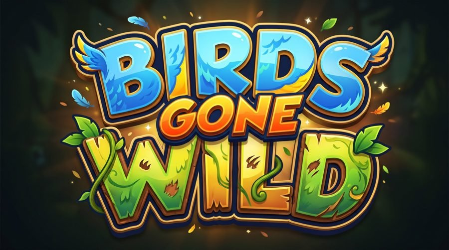
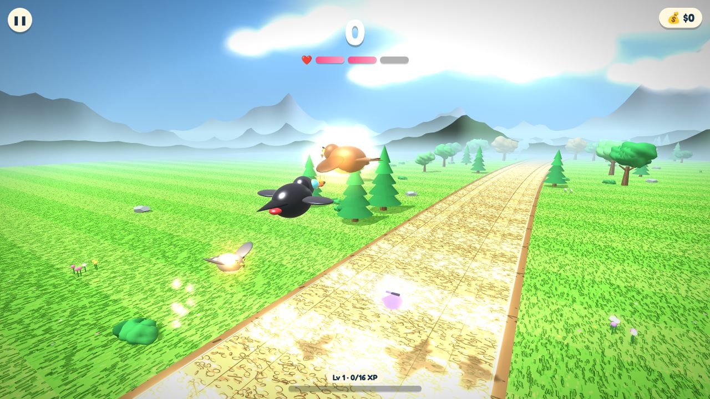
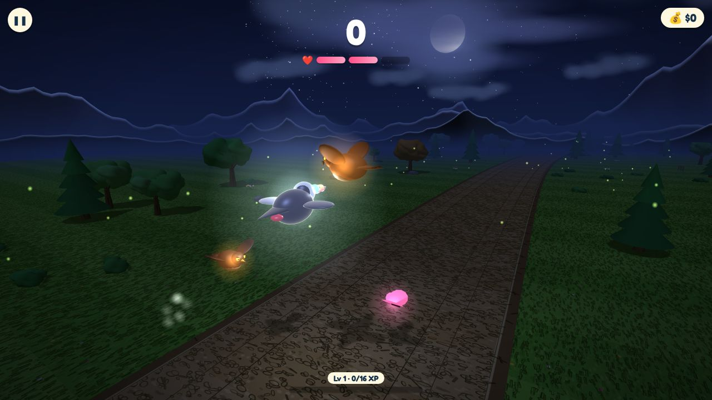
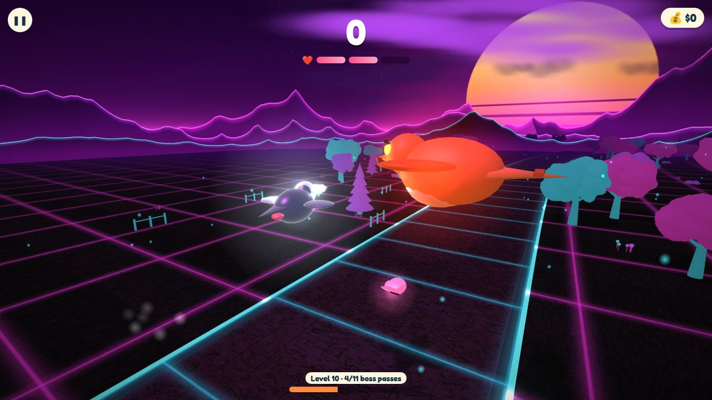

### A fast, free 3D arcade game: fly the toucan, dodge the hawks, beat the bosses.

  
  
  

---

## 🐦 About the game

**Birds Gone Wild** puts you in control of a toucan racing down a winding country road while smart hawks swoop
in from both sides. Tap to flap, read the red **!** warnings, and slip through the gaps. The hawks learn your
habits, change their minds mid-flight and even turn around for a second try.

Play it instantly in any modern browser, or install it to your home screen like a normal app. It works offline too.

## 🎮 Two ways to play

| | Mode | What it is |
|:-:|---|---|
| ♾️ | **Infinite Run** | The classic endless challenge. Survive as long as you can as the hawks get faster and smarter. Earn coins, level up, pick upgrades and chase your best score. |
| 👑 | **Boss Run** | 50 hand-tuned levels, from relaxed to nearly impossible. Dodge waves of hawks, catch butterflies for extra hearts, and face the **Hawk Chief** every 10 levels, joined by his Captains later on. Every hit costs a heart; run out and the run is over. Can you reach level 50? |

Every run starts fresh, so it's pure skill every time.

## ✨ Features

- **Smart hawks**: they predict where you're heading, team up to cut you off, feint, swoop and U-turn.
- **Boss battles**: the giant Hawk Chief and his Captains, with more of them the further you go.
- **Butterflies**: catch them to earn extra hearts (if you can; they dodge too).
- **Day, night and Neon**: a living sky with a moonlit night and a surprise synthwave Neon mode with its own music.
- **Marketplace and upgrades**: spend your coins on shields, magnets and slow-mo, and choose permanent upgrades.
- **Made for phones and PCs**: menus fit any screen, including foldables. Adjustable graphics, sound and frame rate.
- **Installable and offline**: add it to your home screen in a few taps, then play anywhere.

## 🕹️ How to play

| Action | Phone / tablet | Computer |
|---|---|---|
| Flap | Tap anywhere | Click or press <kbd>Space</kbd> |
| Pause | ⏸ button (top left) | <kbd>P</kbd> or <kbd>Esc</kbd> |

**Tips:** the red **!** on the edge of the screen shows where a hawk will cross. Don't hide in the clouds, because
the hawks will find you there. Each flap lifts you quite a bit, so leave room under a hawk.

## 📲 Install it

1. Open **[the game](https://bgwinteractive.github.io/birds-gone-wild/)** in Chrome, Brave, Samsung Internet or Edge
   (Safari on iPhone).
2. Tap **📲 Download App** on the start screen, or use the browser menu: **Install app** / **Add to Home screen**.

Step-by-step pictures: **[Install guide](https://bgwinteractive.github.io/birds-gone-wild/install.html)**

## 🛠️ Under the hood

- Built with **[Three.js](https://threejs.org/)** (WebGL), plain HTML, CSS and JavaScript, with no build step.
- A **Progressive Web App**: a service worker for offline play and a web manifest for installing.
- Hosted on **GitHub Pages** from the `main` branch.
- Organised by topic: [`js/scene`](js/scene) (3D world), [`js/game`](js/game) (rules), [`js/ui`](js/ui) (menus),
  [`js/audio`](js/audio), styles in [`css/`](css/).
- Every change runs automated checks: syntax, file structure, a 4,000-frame headless smoke test, the version number
  and code formatting. See [`tests/`](tests/).
- **Want to help build it?** Read **[CONTRIBUTING](CONTRIBUTING.md)** and the **[architecture guide](docs/ARCHITECTURE.md)**.
- What changed in each version: **[CHANGELOG](CHANGELOG.md)**.

---

**Birds Gone Wild** · made by **BGW Games** · © 2026

[Play now](https://bgwinteractive.github.io/birds-gone-wild/) · [Install guide](https://bgwinteractive.github.io/birds-gone-wild/install.html) · [Changelog](CHANGELOG.md)

